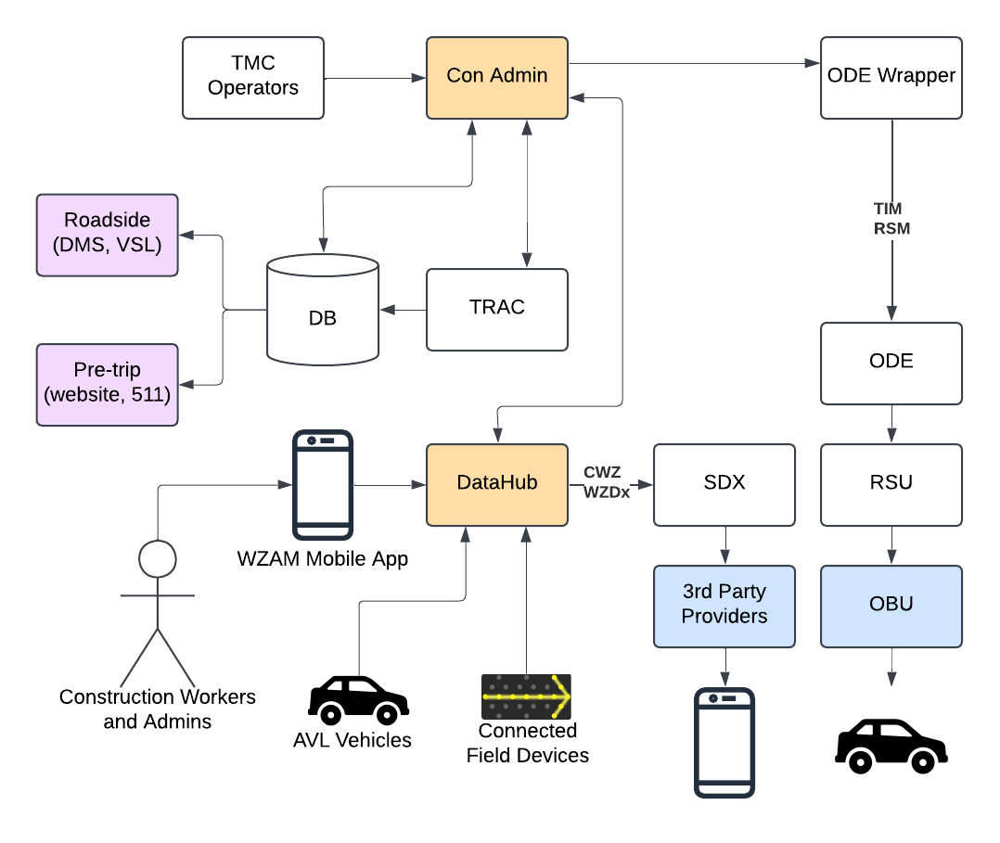
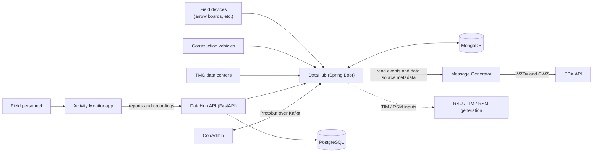
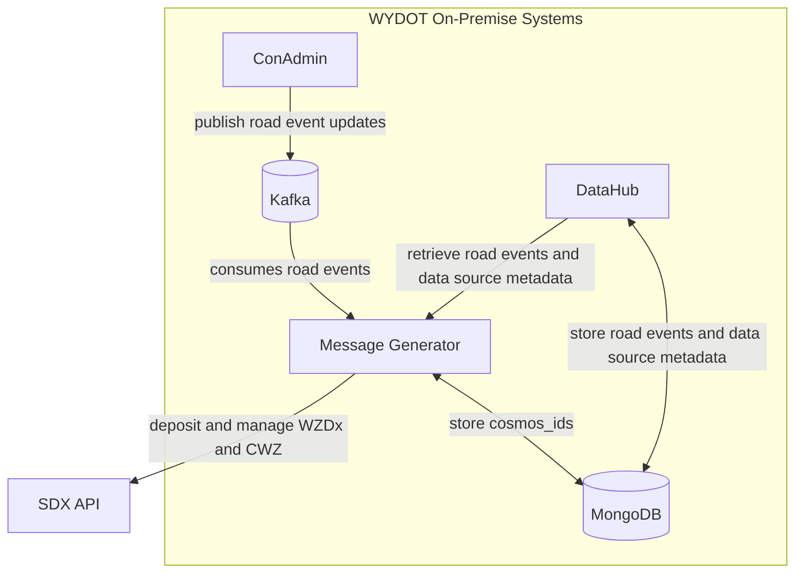
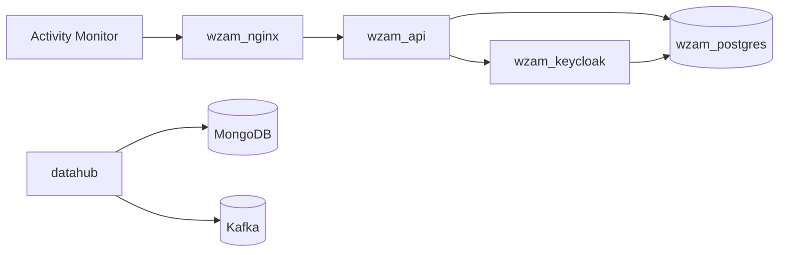
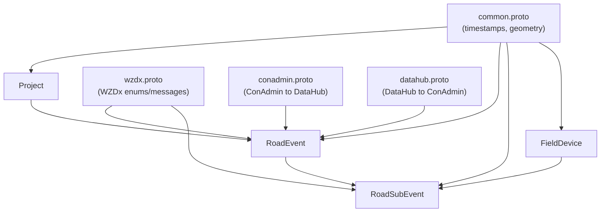

# Wyoming's Work Zone Statewide Enterprise Data Environment (WZ-SEDE)

This repository contains the projects and tools that make up Wyoming's Work Zone Statewide Enterprise Data Environment (WZ-SEDE), part of a 2024 USDOT Smart Grant. This includes projects for collecting, managing, and publishing smart work zone data: a field reporting mobile app, a data hub that aggregates and normalizes work zone information, construction administrator management and review software, shared Protobuf schemas, and a message generator that publishes standardized WZDx and CWZ messages.

## Prerequisites

Each project's README has its own run instructions. Between them, you will need:

| Dependency                | Version                                             | Needed by                                                                                            |
| ------------------------- | --------------------------------------------------- | ---------------------------------------------------------------------------------------------------- |
| Git                       | any recent                                          | all                                                                                                  |
| Docker and Docker Compose | recent                                              | wz-datahub, wz-message-generator (Kafka, MongoDB, PostgreSQL, Keycloak, and the services themselves) |
| JDK                       | 21                                                  | wz-datahub, conadmin (backend), wz-message-generator, wz-datahub-schemas                             |
| Apache Maven              | 3.9+ (`mvnw` wrapper included in message_generator) | Java projects, wz-datahub-schemas                                                                    |
| Flutter SDK               | 3.24.5+ (managed via [fvm](https://fvm.app/))       | wz-activity-monitor                                                                                  |
| Dart SDK                  | bundled with Flutter                                | wz-activity-monitor (`build_runner`)                                                                 |
| Node.js                   | 24+                                                 | conadmin (webapp)                                                                                    |
| Make                      | any recent                                          | conadmin (backend)                                                                                   |
| `protoc`                  | 3.25.x recommended                                  | wz-activity-monitor (Dart protobuf generation); Maven downloads its own for Java                     |

Runtime infrastructure, normally started through the docker compose files:

- **Kafka** for road event and device messaging
- **MongoDB** for DataHub and message generator state
- **PostgreSQL** for reports, recordings, and projects
- **Keycloak** for authentication
- **External access (not included):** an SDX API account for publishing WZDx/CWZ messages, plus ConAdmin and TMC data sources, which are WYDOT systems you must provide or mock

Configuration: copy each project's `sample.env` to `.env` and fill in values. The `wz-datahub-schemas` project is a sibling folder; the Dockerfiles build it automatically, and for local Maven builds run `mvn install` in it first.

## Projects

| Project                                        | Description                                                                                                                                                                        | Stack                                                  |
| ---------------------------------------------- | ---------------------------------------------------------------------------------------------------------------------------------------------------------------------------------- | ------------------------------------------------------ |
| [wz-activity-monitor](./wz-activity-monitor)   | Mobile/web app for field personnel to report work zone activities and record work zones                                                                                            | Flutter / Dart                                         |
| [wz-datahub](./wz-datahub)                     | Aggregates data from TMC data centers, field devices, construction vehicles, and the activity monitor; produces CWZ and WZDx messages and the data needed for TIM and RSM messages | Java Spring Boot, Keycloak, PostgreSQL, MongoDB, Kafka |
| [wz-datahub-schemas](./wz-datahub-schemas)     | Protobuf definitions shared between the DataHub, ConAdmin, and clients                                                                                                             | Protobuf, Maven                                        |
| [wz-message-generator](./wz-message-generator) | Translates road events into WZDx and CWZ messages and deposits them to the SDX                                                                                                     | Java Spring Boot, Kafka, MongoDB                       |

## Architecture

### System context

### Message generation flow

### Deployed services (DataHub docker compose)

### Schema relationships

The Protobuf models in `wz-datahub-schemas` are consumed by the Java projects (generated by Maven) and by the Flutter app (generated with `protoc`).

---

## wz-activity-monitor

Allows authenticated personnel to report work zone activities from the field:

- **Reports**: ongoing one-off work, e.g. lighting repair
  - _static_: non-moving events
  - _mobile_: dynamic events, tied to a license plate or on-device location syncing
- **Recordings**: mapping a work zone road section or activity area by driving through and recording signage and worker presence
- Uploading and downloading reports and recordings

Built off the [Work Zone Data Collection Tool](https://github.com/TonyEnglish/Work_Zone_Data_Collection_Toolset).

Setup, Flutter version management, protobuf generation, and build runner steps: see [wz-activity-monitor/README.md](./wz-activity-monitor/README.md).

---

## wz-datahub

Uses live data from TMC data centers, deployed field devices, active construction vehicles, and Activity Monitor submissions to keep work zone data real-time and accurate, then generates standardized outputs: CWZ and WZDx messages, plus the information required to generate TIM and RSM messages.

Sub-projects:

- `datahub`: receives external data, processes requested updates, and generates output messages (Java Spring Boot)
- `jpo-utils`: utility scripts for managing MongoDB and other infrastructure components
- `resources`: Keycloak and Postgres configuration scripts
- `sample_messages`: directory containing sample message files for testing and reference

Services in its docker compose file:

- datahub: DataHub application, which handles receiving external data, processing requested updates, and generating output messages
- wzam_keycloak: Keycloak image which handles api and reporting app authentication
- wzam_postgres: PostgreSQL server which stores project, road segment, activity area, reports, and recordings
- mongo_full: MongoDB server for storing work zone data
- kafka_full: Kafka broker for message streaming
- kafka_connect: Kafka Connect for integrating Kafka with other systems

Run instructions: see [wz-datahub/README.md](./wz-datahub/README.md) and [wz-datahub/datahub/README.md](./wz-datahub/datahub/README.md).

---

## wz-datahub-schemas

Protobuf schema definitions for DataHub messages:

1. `common.proto`: generic types, including timestamps and geometry
2. `conadmin.proto`: messages from the ConAdmin to the DataHub, keeping the DataHub in sync with ConAdmin changes
3. `datahub.proto`: messages from the DataHub to the ConAdmin, including requested updates and newly registered devices
4. `field_device.proto`: `FieldDevice`, a connected work zone device (like an arrow board) sharing location and other properties
5. `project.proto`: `Project`, a construction project/funding source
6. `road_event.proto`: `RoadEvent`, metadata and location of an entire work zone, linking to multiple road sub events
7. `road_sub_event.proto`: `RoadSubEvent`, a small portion of a work zone with static properties (speed limit, worker presence, lane status)
8. `wzdx.proto`: WZDx message objects and enums used by other messages

Imports use downloaded copies of [google/type](https://github.com/googleapis/googleapis/tree/master/google/type) and [google/protobuf](https://github.com/protocolbuffers/protobuf/tree/main/src/google/protobuf) protos.

Build and library usage: see [wz-datahub-schemas/README.md](./wz-datahub-schemas/README.md).

---

## wz-message-generator

WZDx and CWZ message generators and translators for smart work zone applications (see the architecture diagrams above). It consumes road events from Kafka, retrieves road events and data source metadata from the DataHub, and deposits and manages WZDx/CWZ messages in the SDX. Supporting directories include `jpo-utils/` (Kafka, MongoDB, and Kafka Connect docker setups), `resources/` (Kafka and Keycloak config), `sample_messages/`, and an API collection under `SWZ Message Generator/`.

Run instructions: see [wz-message-generator/README.md](./wz-message-generator/README.md) and [wz-message-generator/message_generator/README.md](./wz-message-generator/message_generator/README.md).

---

## Security note

Never commit `.env` files or credentials. Only the `sample.env` templates are intended to be tracked.
