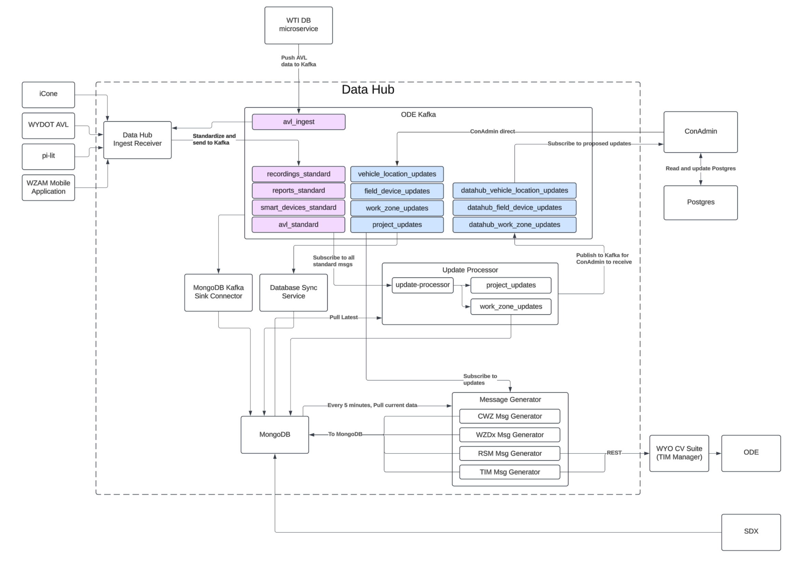

# Work Zone Data Hub

This application uses live data from TMC data centers, deployed field devices, active construction vehicles, and [work-zone-activity-manager](https://bitbucket.org/wyomingdot/wz-activity-manager/src/main/) mobile application submissions to keep work-zone data real-time and accurate. This application uses all of that data to generate standardized message outputs, including CWZ and WZDx messages, as well as the information required to generate TIM and RSM messages.

The DataHub data flows and interfaces are shown here: 

This repository contains the following sub-projects:

- /api
  - API for receiving reports from the reporting app, and managing reports in Postgres
  - Framework: Python [FastAPI](https://fastapi.tiangolo.com/)
- /datahub
  - DataHub application, which handles receiving external data, processing requested updates, and generating output messages
  - Framework: Java SpringBoot
- /resources
  - Keycloak and Postgres database configuration scripts

## Installation

1. Make a copy of the sample.env file and rename it to .env. Fill out the environment variables in the .env file. The .env file is used to set up the database connection and other environment variables for the application.

Docker builds use the repository root as the build context so the shared `wz-datahub-schemas` project is available (`docker compose` handles this).

## Usage

This repository utilized Docker to run and test the services. These services require environment variables. Start by creating a copy of the sample.env file named .env, and fill out the environment variables

After setting up your environment file, use the following command to run all of the services:

```sh
docker compose up --build -d
```

This will run the following images:

- wzam_api: Python api which handles interactions with the reporting app and reads/writes data to postgres
- wzam_keycloak: Keycloak image which handles api and reporting app authentication
- wzam_postgres: PostgreSQL server which stores project, road segment, activity area, reports, and recordings
